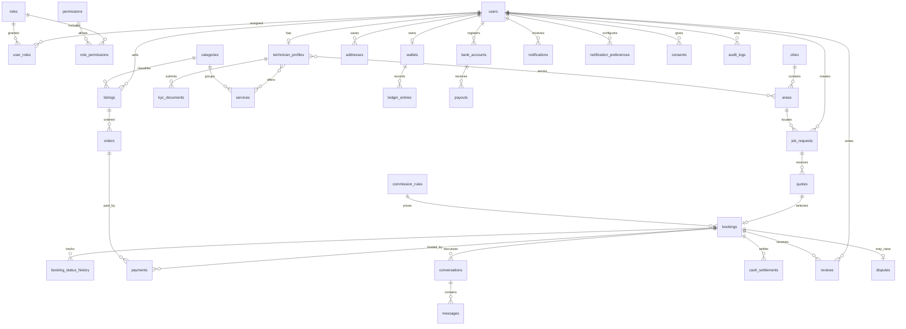

# ServiceHub data model

The ERD below is the forward design for the complete marketplace. Phase 3 implements identity/access, catalog, technician onboarding and KYC. Phase 4 adds job requests, quotes, bookings and conversations using the Prisma names and fields in `packages/db/prisma/schema.prisma`.

## Phase 3 implemented tables

- `categories`: UUID primary key; unique slug; active and marketplace-only flags; sort order and icon key.
- `services`: category FK; unique `(category_id, slug)`; active flag, order and icon key.
- `city_services`: city/service FKs; unique `(city_id, service_id)`; per-city active state.
- `price_guidance`: city/service FKs; unique `(city_id, service_id)`; nonnegative NGN min/max and guide-only label.
- `city_category_flags`: city/category FKs; unique `(city_id, category_id)` and enabled flag.
- `technician_profiles`: unique user FK; city FK; onboarding/approval enum, soft delete, submitted time, profile/availability, encrypted guarantor phone and consent time. Indexes cover `(approval_status, created_at)` and `(city_id, approval_status, submitted_at)`.
- `technician_skills`: composite `(profile_id, service_id)` PK and years of experience; lookup index `(service_id, profile_id)`.
- `technician_areas`: composite `(profile_id, area_id)` PK; lookup index `(area_id, profile_id)`.
- `technician_portfolio`: profile FK, random private object key, caption/order; index `(profile_id, sort_order)`.
- `technician_status_history`: profile FK, nullable actor FK, from/to states, reason/internal note and timestamp; indexes by `(profile_id, created_at DESC)` and `(to_status, created_at)`.
- `technician_kyc`: unique profile FK; encrypted identity number and key ID, unique HMAC blind index, ID type, private document keys, provider/status and retention markers; indexes `(status, submitted_at)` and `(retention_at)`.
- `user_inbox_notifications`: user FK, title/body, read marker and creation time; indexed for unread recent notifications.

Phase 3 records use UUID IDs and UTC `timestamptz` timestamps. KYC object keys are private and never public URLs. The migration is `20261029051904_phase3_catalog_onboarding_kyc`.

## Phase 4 implemented tables

Phase 4 marketplace IDs are application-generated 26-character ULIDs. Foreign keys to existing identity, city, area, service and technician records retain their UUID types. All timestamps are UTC `timestamptz`.

- **job_requests**: ULID PK; customer/service/city/area FKs; optional direct technician FK; required landmark and description; optional coordinate pair; ASAP or a preferred start/end window; optional NGN budget range; urgency/status; expiry; customer-scoped client idempotency key; soft delete. Indexes `(area_id, service_id, status, created_at DESC)`, `(service_id, status, created_at DESC)`, `(customer_id, created_at DESC)`, `(direct_technician_profile_id, status, created_at DESC)`, `(status, expires_at)`. Checks coordinate pair/ranges, required time window when not ASAP, and valid nonnegative budget range.
- **job_request_media**: ULID PK; request FK; private unique object key; image MIME, byte size, order, soft delete. Unique `(request_id, sort_order)`; index `(request_id, created_at)`; size check `1..8,000,000` bytes.
- **quotes**: ULID PK; request and technician FKs; active/versioned quote, integer kobo price and optional labor/material breakdown, ETA, validity, NGN currency and client idempotency key. Unique `(job_request_id, technician_profile_id, active_slot)` where only active quotes keep the `ACTIVE` slot; PostgreSQL's NULL-distinct unique behavior permits prior inactive quotes. Unique idempotency key; indexes `(job_request_id, status, created_at)`, `(technician_profile_id, status, created_at DESC)`, `(status, valid_until)`. Checks nonnegative amounts, positive version and expiration after creation.
- **quote_revisions**: ULID PK; quote FK; unique `(quote_id, version)`; JSON quote snapshot; index `(quote_id, created_at DESC)`. Revisions are retained when an active quote is edited.
- **bookings**: ULID PK; unique request and quote FKs; customer and technician FKs; status, selected `ONLINE`/`CASH` method, integer NGN price and fee preview, commission-rule snapshot, unique acceptance idempotency key, acceptance/completion timestamps and soft delete. Indexes `(customer_id, status, created_at DESC)`, `(technician_profile_id, status, accepted_at DESC)`, `(status, created_at)`. Check positive price, nonnegative fee and NGN currency.
- **booking_status_history**: ULID PK; booking FK; from/to states, actor FK/role, reason and creation time; indexes `(booking_id, created_at)`, `(to_status, created_at)`, `(actor_user_id, created_at DESC)`.
- **cancellations**: ULID PK; unique booking FK; actor FK; reason code/text, unique client idempotency key and creation time; index `(actor_user_id, created_at DESC)`.
- **technician_availability_blocks**: ULID PK; technician FK; `starts_at`, `ends_at`, optional reason and creation time; check end after start; index `(technician_profile_id, starts_at, ends_at)`.
- **conversations**: ULID PK; request FK, optional unique booking FK, technician FK, open/closed state; unique `(job_request_id, technician_profile_id)`; index `(technician_profile_id, updated_at DESC)`.
- **conversation_participants**: composite PK `(conversation_id, user_id)`; participant role, join time and read cursor; index `(user_id, last_read_at)`.
- **messages**: ULID PK; conversation/sender FKs; client-generated idempotency key; text body and edit/delete timestamps; unique `(conversation_id, sender_id, client_message_key)`; indexes `(conversation_id, created_at DESC, id DESC)`, `(sender_id, created_at DESC)`.
- **message_attachments**: ULID PK; message FK; private unique object key, image MIME, byte size and creation time; index `(message_id, created_at)`; size check `1..8,000,000` bytes.
- **message_flags**: ULID PK; unique message FK; nonempty moderation signal array, review status, optional reviewer FK/note/timestamp; indexes `(status, created_at DESC)`, `(reviewed_by_id, reviewed_at)`. Flags are signals for review, not proof of misconduct.

The migration is `20261029065557_phase4_jobs_bookings_chat`; SQL constraints in that migration enforce fixed-width ULIDs, coordinate/time/budget checks, kobo ranges, media limits and quote active-slot consistency. Accept, cancellation and expiry paths serialize on the request row; technician booking capacity serializes on the technician profile row.

IDs are UUIDs. All monetary values are integer minor units (kobo) with an ISO currency code. Timestamps are UTC `timestamptz`. Unless stated, tables include `created_at`, `updated_at`; mutable catalog and profile tables may have `deleted_at`, while financial, consent and audit records are append-only or retained according to policy. `tenant_id` is intentionally omitted: launch is one platform serving many cities, not a multi-tenant SaaS.

## Table definitions, constraints and indexes

Names are snake_case. `PK` means primary key, `FK` foreign key. Every FK is indexed unless its leading columns are already covered by a composite index. Add checks below as database constraints, not only application validation.

### Identity, access, consent and audit

- **users**: `id PK`, `phone_e164 NULL`, `email NULL`, `display_name`, `status`, `preferred_otp_channel`, `locale`, `deleted_at`. Unique partial indexes on normalized non-null phone and email; check at least one login identifier exists for active users; indexes on `(status, created_at)`.
- **roles**: `id PK`, `key UNIQUE`, `name`, `description`, `is_system`; unique key index.
- **permissions**: `id PK`, `key UNIQUE`, `description`; unique key index.
- **user_roles**: `user_id FK`, `role_id FK`, `assigned_by FK users NULL`, `created_at`; composite PK `(user_id, role_id)`; index `(role_id, user_id)`.
- **role_permissions**: `role_id FK`, `permission_id FK`; composite PK `(role_id, permission_id)`; index `(permission_id, role_id)`.
- **sessions**: `id PK`, `user_id FK`, `refresh_token_hash UNIQUE`, `device_label`, `ip_hash`, `expires_at`, `revoked_at`; indexes `(user_id, revoked_at)`, `(expires_at)`.
- **otp_codes**: `id PK`, `user_id FK NULL`, `destination_hash`, `purpose`, `code_hash`, `channel`, `expires_at`, `attempt_count`, `consumed_at`; checks `attempt_count BETWEEN 0 AND 5`; indexes `(destination_hash, purpose, created_at DESC)`, `(expires_at)`.
- **oauth_accounts**: `id PK`, `user_id FK`, `provider`, `provider_subject`; unique `(provider, provider_subject)`; index `(user_id, provider)`.
- **consents**: `id PK`, `user_id FK`, `purpose`, `policy_version`, `granted`, `captured_at`, `withdrawn_at`, `source`, `evidence_json`; append-only consent events; indexes `(user_id, purpose, captured_at DESC)`, `(policy_version, purpose)`.
- **data_subject_requests**: `id PK`, `user_id FK`, `request_type` (`EXPORT`/`DELETE`), `status`, `requested_at`, `verified_at NULL`, `completed_at NULL`, `completed_by FK users NULL`, `export_object_key NULL`, `expires_at NULL`, `decision_note NULL`; checks valid timestamps and completed requests have `completed_at`; indexes `(user_id, requested_at DESC)`, `(status, requested_at)`, `(expires_at)`; exported files are private, short-lived and deleted after expiry.
- **kyc_documents**: `id PK`, `technician_id FK`, `document_type`, `private_object_key UNIQUE`, `encrypted_identifier NULL`, `status`, `reviewed_by FK users NULL`, `reviewed_at`, `retention_until`; indexes `(technician_id, status)`, `(retention_until)`; never store public URLs or plaintext NIN/ID numbers. Application-level authenticated encryption with key version metadata; restrict decryption to approved workflows.
- **settings**: `id PK`, `key`, `value_json`, `scope_type`, `scope_id` (`global` sentinel for global scope), `updated_by FK users NULL`; unique `(scope_type, scope_id, key)`; indexes `(scope_type, scope_id)`, `(updated_by)`.
- **audit_logs**: `id PK`, `actor_user_id FK users NULL`, `action`, `entity_type`, `entity_id`, `ip_hash`, `metadata_json`, `created_at`; append-only; indexes `(actor_user_id, created_at DESC)`, `(entity_type, entity_id, created_at DESC)`, `(action, created_at DESC)`.

### Geography and service catalog

- **cities**: `id PK`, `name`, `slug UNIQUE`, `country_code`, `currency_code`, `timezone`, `is_active`; unique `(country_code, slug)`; index `(is_active, name)`.
- **areas**: `id PK`, `city_id FK`, `name`, `slug`, `parent_area_id FK areas NULL`, `center_lat NULL`, `center_lng NULL`, `is_active`; unique `(city_id, slug)`; checks latitude `[-90,90]`, longitude `[-180,180]`; indexes `(city_id, is_active, name)`, `(parent_area_id)`.
- **addresses**: `id PK`, `user_id FK`, `city_id FK`, `area_id FK`, `label`, `nearest_landmark`, `street_address NULL`, `latitude NULL`, `longitude NULL`, `is_default`; landmark required; coordinate pair must be both null or both present; unique partial `(user_id) WHERE is_default`; indexes `(user_id, created_at DESC)`, `(area_id)`.
- **categories**: `id PK`, `parent_category_id FK categories NULL`, `name`, `slug UNIQUE`, `enabled`, `sort_order`; index `(enabled, sort_order)`.
- **services**: `id PK`, `category_id FK`, `name`, `slug`, `description`, `price_min_kobo NULL`, `price_max_kobo NULL`, `currency_code`, `enabled`; unique `(category_id, slug)`; checks nonnegative prices and `min <= max`; index `(category_id, enabled, name)`.
- **technician_profiles**: `id PK`, `user_id FK UNIQUE`, `public_name`, `bio`, `approval_status`, `availability_status`, `verified_at NULL`, `guarantor_contact_encrypted NULL`, `deleted_at`; index `(approval_status, availability_status)`.
- **technician_services**: `technician_id FK`, `service_id FK`, `custom_price_min_kobo NULL`, `custom_price_max_kobo NULL`; composite PK; price checks; index `(service_id, technician_id)`.
- **technician_areas**: `technician_id FK`, `area_id FK`, `is_primary`; composite PK; index `(area_id, technician_id)`.
- **addresses** and technician service areas are not interchangeable: job location is an address snapshot and matching may expand by configured radius.

### Jobs, bookings and communication

- **job_requests**: `id PK`, `customer_id FK`, `service_id FK`, `city_id FK`, `area_id FK`, `address_id FK NULL`, `landmark_snapshot`, `description`, `latitude NULL`, `longitude NULL`, `status`, `requested_at`; coordinate-pair check; indexes `(status, area_id, requested_at DESC)`, `(customer_id, created_at DESC)`, `(service_id, status)`; add PostGIS geography/GiST index when installed, otherwise a bounded lat/lng index strategy.
- **quotes**: `id PK`, `job_request_id FK`, `technician_id FK`, `price_kobo`, `currency_code`, `message`, `expires_at`, `status`; check price nonnegative; unique partial `(job_request_id, technician_id) WHERE status IN ('OPEN','ACCEPTED')`; indexes `(job_request_id, status, created_at)`, `(technician_id, status, created_at DESC)`.
- **bookings**: `id PK`, `job_request_id FK`, `quote_id FK UNIQUE`, `customer_id FK`, `technician_id FK`, `commission_rule_id FK NULL`, `service_amount_kobo`, `platform_fee_kobo`, `currency_code`, `payment_method`, `status`, `committed_at NULL`, `completed_at NULL`; all amounts nonnegative; indexes `(customer_id, status, created_at DESC)`, `(technician_id, status, created_at DESC)`, `(status, created_at)`.
- **booking_status_history**: `id PK`, `booking_id FK`, `from_status NULL`, `to_status`, `actor_user_id FK NULL`, `note`, `created_at`; index `(booking_id, created_at)`.
- **payments**: `id PK`, `booking_id FK NULL`, `order_id FK NULL`, `gateway`, `gateway_reference UNIQUE`, `idempotency_key UNIQUE`, `amount_kobo`, `currency_code`, `status`, `ledger_state`, `paid_at NULL`; exactly one of booking/order must be set; check `amount_kobo > 0`; indexes `(booking_id, created_at)`, `(order_id, created_at)`, `(status, created_at)`, `(ledger_state, created_at)`.
- **conversations**: `id PK`, `booking_id FK NULL`, `order_id FK NULL`, `created_by FK users`, `status`; exactly one of booking/order required; indexes `(booking_id)`, `(order_id)`, `(created_at DESC)`.
- **messages**: `id PK`, `conversation_id FK`, `sender_id FK users`, `body`, `attachment_object_key NULL`, `moderation_flags`, `read_at NULL`; index `(conversation_id, created_at)`, `(sender_id, created_at DESC)`; do not put raw phone or sensitive KYC data into audit metadata.
- **reviews**: `id PK`, `booking_id FK`, `author_id FK`, `subject_user_id FK`, `rating`, `comment NULL`, `visibility`; check rating `1..5`; unique `(booking_id, author_id)`; indexes `(subject_user_id, created_at DESC)`, `(rating, created_at)`.
- **disputes**: `id PK`, `booking_id FK UNIQUE`, `opened_by FK`, `reason`, `description`, `status`, `resolution NULL`, `resolved_by FK NULL`, `resolved_at NULL`; indexes `(status, created_at)`, `(opened_by, created_at DESC)`.
- **notifications**: `id PK`, `user_id FK`, `channel`, `template_key`, `payload_json`, `status`, `provider_reference NULL`, `attempt_count`, `scheduled_at`, `sent_at NULL`; indexes `(user_id, created_at DESC)`, `(status, scheduled_at)`, `(provider_reference)`.
- **notification_preferences**: `id PK`, `user_id FK`, `channel`, `event_key`, `enabled`; unique `(user_id, channel, event_key)`; index `(channel, event_key, enabled)`.

### Money, settlement and marketplace

- **commission_rules**: `id PK`, `name`, `category_id FK NULL`, `city_id FK NULL`, `calculation_type`, `rate_basis_points NULL`, `flat_amount_kobo NULL`, `effective_from`, `effective_to NULL`, `priority`, `enabled`; exactly one calculation value per type; percent `0..10000`; valid date range; index `(enabled, category_id, city_id, effective_from DESC)`.
- **wallets**: `id PK`, `user_id FK UNIQUE`, `currency_code`, `balance_kobo`, `updated_at`; balance is materialized from ledger and reconciled; index `(currency_code, balance_kobo)` for operational controls.
- **ledger_entries**: `id PK`, `wallet_id FK`, `booking_id FK NULL`, `payment_id FK NULL`, `cash_settlement_id FK NULL`, `entry_type`, `direction`, `amount_kobo`, `currency_code`, `idempotency_key UNIQUE`, `reverses_entry_id FK NULL`; positive amount; exactly one economic source is populated; indexes `(wallet_id, created_at)`, `(booking_id)`, `(payment_id)`, `(cash_settlement_id)`; immutable, corrections use reversing entries.
- **bank_accounts**: `id PK`, `user_id FK`, `bank_code`, `account_number_encrypted`, `account_name`, `gateway_recipient_code NULL`, `verified_at NULL`, `is_default`, `deleted_at`; unique `(user_id, bank_code, account_fingerprint)` with keyed HMAC fingerprint; unique partial one default per user; indexes `(user_id, deleted_at)`, `(gateway_recipient_code)`.
- **payouts**: `id PK`, `user_id FK`, `bank_account_id FK`, `amount_kobo`, `currency_code`, `status`, `gateway`, `gateway_reference UNIQUE NULL`, `idempotency_key UNIQUE`, `requested_at`, `processed_at NULL`, `failure_reason NULL`; amount positive; indexes `(user_id, created_at DESC)`, `(status, created_at)`, `(bank_account_id, created_at DESC)`.
- **cash_settlements**: `id PK`, `booking_id FK UNIQUE`, `technician_id FK`, `gross_amount_kobo`, `commission_amount_kobo`, `status`, `confirmed_by FK users NULL`, `confirmed_at NULL`; checks gross > 0 and commission between 0 and gross; indexes `(technician_id, status, created_at DESC)`, `(status, created_at)`.
- **listings**: `id PK`, `seller_id FK`, `category_id FK`, `city_id FK`, `area_id FK`, `title`, `description`, `condition`, `price_kobo`, `currency_code`, `status`, `published_at NULL`; price >= 0; indexes `(city_id, area_id, status, published_at DESC)`, `(seller_id, status, created_at DESC)`, `(category_id, status, created_at DESC)`.
- **listing_images**: `id PK`, `listing_id FK`, `private_object_key UNIQUE`, `sort_order`; unique `(listing_id, sort_order)`; index `(listing_id, sort_order)`.
- **orders**: `id PK`, `buyer_id FK`, `listing_id FK`, `seller_id FK`, `quantity`, `unit_price_kobo`, `platform_fee_kobo`, `currency_code`, `status`, `idempotency_key UNIQUE`; quantity > 0, all money nonnegative; indexes `(buyer_id, created_at DESC)`, `(seller_id, status, created_at DESC)`, `(listing_id, status)`.
- **commission snapshots**: booking/order preserve the applied rate and calculated amount at commitment time so later rule edits never rewrite history.

## Retention and erasure notes

Retention configuration lives in scoped `settings` records (for example `retention.kyc_days`, `retention.message_days`, `retention.export_ttl_hours`) and must have an audit trail. Deletion requests enter `data_subject_requests`, verify the requester, export or delete/anonymize data by domain, preserve records only where an approved legal retention rule applies, then record completion. Confirm the legal retention schedule and NDPA obligations before enabling automated deletion. KYC objects must be purged on the approved schedule; deletion of an object and its encryption key metadata should be auditable without retaining the identity number.

## Phase 4 schema implementation notes

The Phase 4 Prisma models are `job_requests`, `job_request_media`, `quotes`, `quote_revisions`, `bookings`, `booking_status_history`, `cancellations`, `technician_availability_blocks`, `conversations`, `conversation_participants`, `messages`, `message_attachments` and `message_flags`. IDs in this domain are 26-character ULIDs generated by the API; timestamps are PostgreSQL `timestamptz(6)` UTC values. Soft-delete timestamps are on requests, bookings and messages; request media also has a deletion timestamp.

Indexes include `(area_id, service_id, status, created_at DESC)`, `(service_id, status, created_at DESC)`, `(status, expires_at)`, customer/technician status pagination, quote request/status and technician/status pagination, booking status and technician schedule range, conversation participant and message chronological pagination. Constraints enforce one booking per request and quote, one active quote slot per technician/request, unique idempotency keys, one conversation per request/technician, paired map coordinates, valid time/budget windows, positive quote amounts, and valid attachment limits. The booking history's `(booking_id, client_action_key)` unique index supports idempotent status actions.

Migration sequence for this phase is `20261029065557_phase4_jobs_bookings_chat`, `20261029070000_phase4_booking_windows_cancellations`, and `20261029071000_phase4_state_machine`. Payment fields in the broader ERD are future Phase 5 models; Phase 4 does not create charges or hold money.
