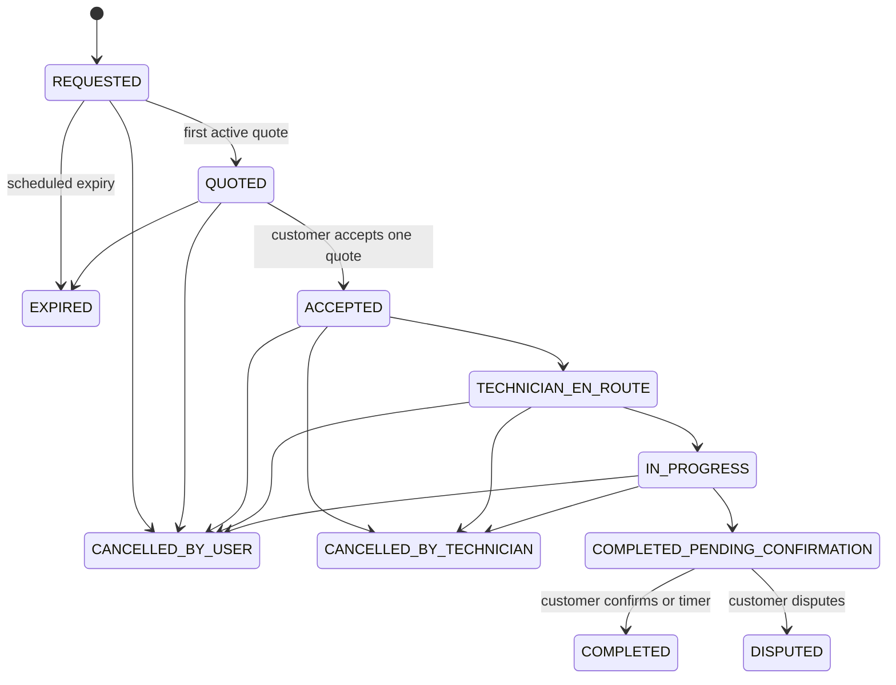

# Jobs, quotes and bookings (Phase 4)

## State flow

`booking-primitives.ts` is the transition authority. Every transition writes a status-history record. Dispute resolution remains Phase 6. The default completion confirmation window is 48 hours. Cancellation is available with a reason; fees are not assessed in Phase 4.

## Request and matching

An open request is sent to the top configured number of matching technicians. A direct request restricts matching to the selected technician. Matching requires active, approved profiles with the requested service, city, area, and a non-overlapping schedule. Weekly availability defaults to available when the profile has no weekly schedule; explicit unavailable weekdays are excluded. Availability blocks and active bookings use half-open UTC intervals. When both coordinates and area centers exist, the default strategy ranks by distance, rating, response rate, last activity, then stable profile ID. Rating and response rate remain placeholders until reviews and response metrics are populated. Notification preferences and per-technician hourly limits are checked before enqueueing.

## Quotes and acceptance

Prices are integer NGN kobo. Each technician has one active quote slot per request. Revisions preserve snapshots. Quote acceptance locks the request row and technician profile row, checks expiry, eligibility, booking capacity and overlapping time, and creates the single booking inside a serializable transaction. Unique request and quote constraints enforce one booking per request/quote; the idempotency key makes a retry return the original booking. Competing quotes are marked `NOT_SELECTED` in the same transaction. Payment is represented by `PaymentGate`; Phase 4 ships `NoopPaymentGate` and stores the chosen payment method without charging.

## Contact and moderation

Counterpart phone details are revealed only through the booking contact endpoint after acceptance, and every reveal produces an audit entry. The reveal window closes 24 hours after completion by default. Message moderation flags phone numbers, off-platform payment language, and external links; it records signals without blocking a message. Admin moderation pages must state “Signal, not proof.”

## Configurable settings seeded for launch

`matching.top_n=10`, `matching.technician_hourly_limit=3`, `booking.max_active_per_technician=3`, `booking.allow_overlapping=false`, `booking.auto_complete_hours=48`, `booking.cancel_user_before_start_hours=24`, `booking.cancel_technician_window_hours=24`, `booking.phone_reveal_after_completion_hours=24`, `request.expiry_hours=24`, `quote.expiry_hours=24`, and `message.max_per_minute=20`. Admin setting changes are audit-logged.

## Outstanding product decisions

- Confirm cancellation windows and whether user and technician windows differ.
- Confirm the auto-complete window and any excluded job categories.
- Confirm maximum concurrent active bookings and whether overlapping jobs may ever be allowed.
- Confirm per-technician notification limits and the initial top-N matching batch.
- Confirm the post-completion contact reveal window.
