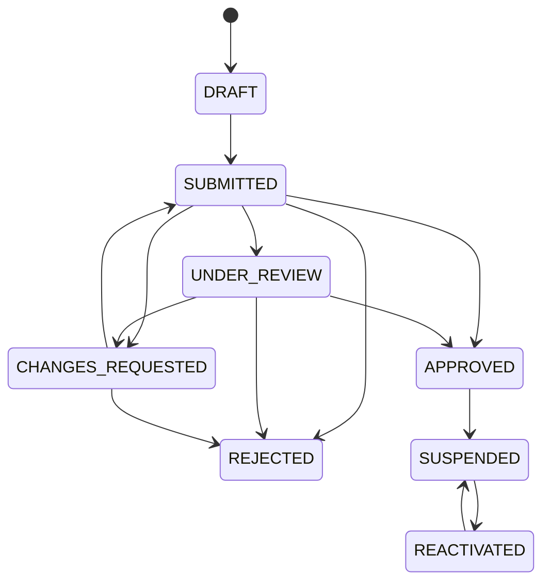

# Technician onboarding and identity checks

## Status flow

Every transition is validated in `technician-primitives.ts`, written to `TechnicianStatusHistory` and audited. Reasons are mandatory for changes requested, rejection and suspension. Only approved/reactivated technicians appear in the public listing.

## Collected data and purpose

| Data | Purpose | Storage/access |
| --- | --- | --- |
| Legal/display name, bio, profile photo | Technician profile | Profile records; public display name/photo only after approval |
| Phone verification | Account recovery and approval prerequisite | Existing user phone and OTP workflow |
| Services, years, areas, weekly availability, portfolio | Match customers to providers | Profile relations; portfolio photos private until approved |
| ID type and number, ID photo, selfie | Manual identity review | ID number AES-256-GCM encrypted with key ID; HMAC blind index; files in private MinIO bucket |
| Guarantor name, phone, relationship and consent | Optional city policy/reference | Phone encrypted using the KYC key interface; no contact is sent in this phase |
| KYC consent version/time | NDPA consent evidence | Consent record |

KYC requires `kyc.view`; reveal requires `kyc.view_sensitive`, a reason, and an audit event. Document links are signed for at most five minutes. Uploads use random user-scoped keys, a strict image allowlist, size check, magic-byte check, EXIF stripping and a scanner interface (the current scanner is a no-op). Do not enable production KYC until a real malware scanner and managed key provider are configured.

## Retention

| Event | Current behaviour | Decision needed |
| --- | --- | --- |
| Rejected application | KYC data is scheduled for cleanup after the city `kyc.retention_days` setting, falling back to `KYC_RETENTION_DAYS` (default 365); private files and encrypted identifiers are removed, with a minimal outcome record retained | Nigerian counsel/business owner must approve the period and exceptions |
| Account closure | Fulfilment workflow is not yet implemented | Define legal holds, timing and notice |
| Guarantor details | Retained with technician profile; no separate expiry implemented | Set purpose and retention period |

City admin settings expose the guarantor requirement (default false) and retention days. A configured guarantor requirement is enforced during application submission; optional guarantor details are collected only with the contact's consent. Retention is explicitly flagged as needing counsel approval. The provider interface currently uses manual admin review only; no paid identity provider is connected. Account-closure fulfilment is tracked in Phase 7.
